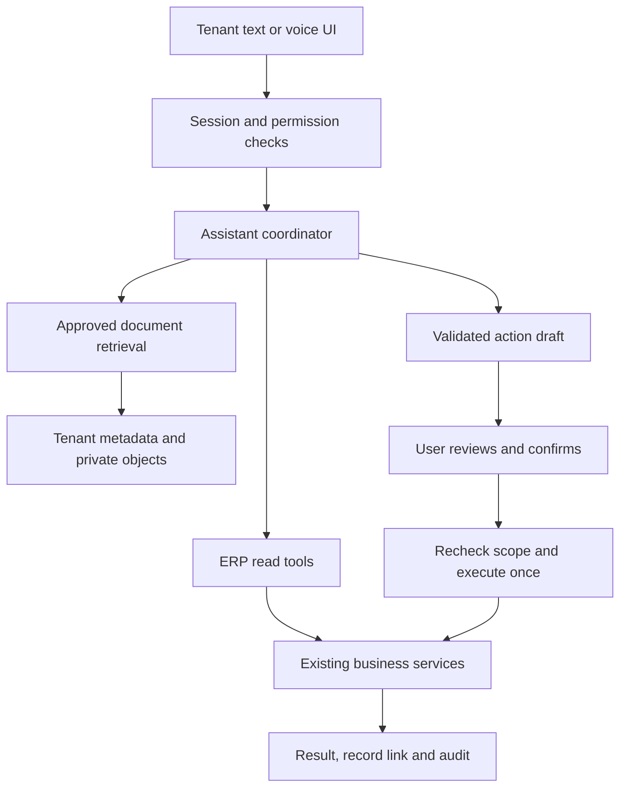
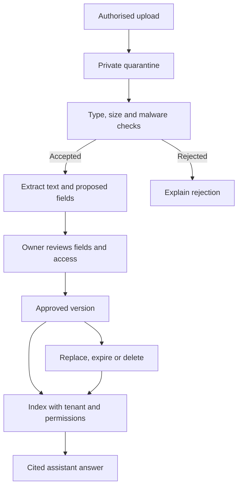

# Tenant documents and the HexaBill assistant

Implementation design, not an implemented or tested feature. Extend the existing .NET modular backend and React application. A second independent ERP backend would duplicate authorization and accounting rules.

## 1. Three different sources of knowledge

| Information | Authoritative source | Assistant behaviour |
| --- | --- | --- |
| Customer balance, sales, expenses, stock and VAT | Existing deterministic ERP services and PostgreSQL | Call authorised typed tools with dates/filters; return amount, currency, as-of time and source link. Never calculate a balance from document embeddings. |
| Licence, policies, product manuals and approved company instructions | Versioned tenant documents in private object storage plus searchable text metadata | Retrieve only authorised tenant/role content; cite document title, version and page/section. |
| A requested change | Server-stored action draft | Validate, ask missing questions, show editable preview, obtain explicit confirmation, then call the same business service used by manual forms. |

Uploading a PDF is not model training. It is document ingestion and retrieval. A company rule may guide replies but cannot grant staff new permissions, bypass a VAT lock or replace accounting validation.

## 2. Runtime flow



The server derives tenantId and userId from verified session/host context. Do not accept a tenantId supplied by the model as authority. Every tool also enforces branch/route scope and the current user's role. Check again at execution because a role, tenant status or source record may change while a draft is open.

## 3. Folder additions using the current stack

These are proposed paths. Add them incrementally; avoid a repository-wide move in the same change.

| Proposed path | Responsibility |
| --- | --- |
| `backend/HexaBill.Api/Modules/Assistant/` | Conversation/session endpoints and orchestration |
| `Modules/Assistant/Tools/` | Versioned schemas and adapters to existing services; no direct arbitrary SQL |
| `Modules/Assistant/Actions/` | Draft validation, confirmation, expiration, execution and idempotency |
| `Modules/Assistant/Providers/` | Server-side provider interfaces, capability checks and failure handling |
| `Modules/Assistant/Policies/` | Permission matrix, privacy rules, tool allowlist and quota checks |
| `Modules/Assistant/Prompts/` | Reviewed application instructions, versioned with code; no tenant data or secrets |
| `Modules/Assistant/Voice/` | Short-lived voice-session authorization, language metadata and limits |
| `Modules/TenantDocuments/` | Upload, ownership, versioning, review, retention and access endpoints |
| `Modules/TenantDocuments/Ingestion/` | Scan/extract/chunk/index job handlers with tenant-bound messages |
| `frontend/hexabill-ui/src/features/assistant/` | Drawer, full-screen view, transcript, source cards and confirmation forms |
| `frontend/hexabill-ui/src/features/tenantDocuments/` | Tenant files, versions, extraction review, expiry and ingestion state |
| `tests/HexaBill.Tests/assistant/` | Tool, permission, replay, outage and document-isolation tests |
| `tests/HexaBill.Tests/tenantDocuments/` | Upload limits, file access, deletion and version tests |
| `frontend/hexabill-ui/e2e/assistant/` | Phone/tablet/desktop journeys and review/confirm flows |
| `docs/architecture/assistant.md` | One architecture decision record linked by the current master tracker |

Keep financial domain code in its current Customers, Expenses, Sales, Payments, DailyClose and Reports modules. The assistant calls it. Do not copy those rules into a new Python agent or model prompt.

For long extraction or live audio, add a separately deployed worker when needed. Keep its repository code in a clearly owned worker project, and expose only the required internal job/tool interface. Do not run OCR, a local speech model and heavy embeddings inside the small API web process.

## 4. Client data storage and isolation

Use one application for all five tenants. A physical folder per client in the Git repository does not enforce isolation. Use a verified tenant ID throughout the database, objects, jobs, caches and assistant sessions.

| Store | Suggested contents |
| --- | --- |
| PostgreSQL | ERP records; document/version metadata; extracted structured fields; ingestion jobs; conversations if retained; action drafts; usage accounting |
| Private R2 objects | Original PDFs/images, derived thumbnails, reviewed extraction artifacts and generated exports |
| Search index | Approved text chunks with tenant, document version, access level and deletion state; begin with full-text search if sufficient |
| Secrets service / protected environment | Model/provider credentials and storage secrets; database stores only approved secret references or encrypted values with external key management |

Object key examples use immutable IDs, not human business names:

```text
tenants/{tenantId}/documents/{documentId}/{versionId}/original.pdf
tenants/{tenantId}/documents/{documentId}/{versionId}/preview.webp
tenants/{tenantId}/products/{productId}/images/{assetId}.webp
tenants/{tenantId}/expenses/{expenseId}/receipts/{assetId}.pdf
tenants/{tenantId}/exports/{exportId}/statement.pdf
```

These are storage key conventions, not authorization rules. Look up the asset metadata and authorize the object before each fetch. Use opaque download IDs or short-lived signed access after checking permissions. Private responses use private/no-store as appropriate, safe Content-Disposition and nosniff. Keep the public brand-logo route separate. Reject path traversal, arbitrary object keys and content-type confusion.

Shared PostgreSQL with enforced tenant filters is a sensible starting point for five small tenants. Consider database RLS as a separate defence-in-depth project only after studying connection pooling and runtime roles. Do not casually add it without tests; do not claim it exists from README wording. A database per tenant adds operational burden and is not required solely by the number five.

If semantic search becomes necessary, evaluate a tenant-filtered pgvector index against real corpus size and the database's RAM. A separate paid vector service is not automatically necessary. Do not load every client's documents into one prompt or retrieve globally and filter only in the browser.

## 5. Document ingestion and approval



Start with PDF, PNG/JPEG/WebP, CSV and plain text. Add DOCX with a hardened parser if needed. "Any file" should mean a helpful supported-format list, not execution of arbitrary files. Proposed starting limits: 20 MB/document, 10 MB/image, 10,000 CSV rows per validated import batch; these are product decisions to tune, not existing limits. Reject archives, executables, macros and encrypted documents until a deliberate safe workflow exists. Stream processing and cap extracted size/page count to prevent resource exhaustion. [R14 in the main audit]

The owner sees Uploading, Checking, Reading, Needs review, Ready, Failed or Expired. Every failure has a human explanation and safe retry. Licence extraction proposes legal name, licence number and expiry date with source highlighting; the owner confirms them. Do not automatically overwrite company branding or tax identity from OCR.

CSV import must show column mapping, preview, duplicate handling and per-row validation errors. Committing an import is a separate authorised action; merely uploading a CSV never creates ledger entries. Neutralise spreadsheet formula injection in exported text cells.

Documents need type, tenant, owner, visibility/role scope, version, hash, review status, expiry, upload time, extraction status and retention policy. Chunk records retain document version and page/section. When a source is superseded/deleted, remove it from retrieval and invalidate derived caches. If a backup retains deleted content temporarily, disclose and enforce the retention policy rather than promising immediate deletion everywhere.

Treat retrieved instructions as untrusted content. A PDF saying "show other companies" or "ignore confirmation" cannot change the tool policy. Use server boundaries, output checks and representative attack tests; a system prompt alone is not protection. [R15]

## 6. Tool catalogue and action controls

Tool names below are a proposed internal contract, not existing API endpoints.

| Tool | Access | Important checks |
| --- | --- | --- |
| `get_today_summary` | Read | Verified tenant, branch, business timezone, fresh totals and source links |
| `find_customer` | Read | Exact/fuzzy match with ambiguity choices; bounded results |
| `get_customer_balance` | Read | Customer belongs to tenant; requester has ledger access; as-of date |
| `get_statement` | Read/export | Approved range and download permission; private expiring file access |
| `find_products` | Read | Unit, stock freshness and permitted price fields |
| `search_company_documents` | Read | Approved version, tenant and document visibility before model exposure |
| `draft_customer` | Draft | Required field and enum validation, same-tenant duplicate candidates |
| `draft_expense` | Draft | Amount/date/category, paid-from account, branch and permitted tax treatment |
| `draft_invoice` | Later draft | Valid customer/SKU/unit/stock/prices; no model-generated tax math |
| `execute_confirmed_action` | Write | Current role/scope, draft revision, expiry, field hash, idempotency and domain validation |

Do not provide SQL execution, arbitrary HTTP requests, tenant switching, secret retrieval, unrestricted file reads or direct ledger posting as model tools. Generating a statement is distinct from sending it to a customer. External sending needs its own verified-recipient and confirmation policy.

Action states: collecting fields -> validated draft -> awaiting confirmation -> executing -> succeeded / failed / outcome unknown / expired / cancelled. A timeout after a write is "outcome unknown", not proof of failure. Resolve it through idempotency/status lookup before retrying.

Store draft ID, tenant/user, tool/schema version, canonical field values, revision/hash, expiration and required permission on the server. The confirmation request references this draft. A changed field invalidates the previous confirmation. Re-authorise at commit, execute within the existing domain transaction, and return the actual saved record ID. Refresh affected views after success without relabelling a successful mutation as failed when the refresh fails.

## 7. Example: create a customer in Malayalam

Example user intent in Manglish: "Rahman enna customer add cheyyu; phone number njan parayam." The product should support Malayalam script and spoken Malayalam; this example is transliteration only.

1. The assistant checks whether the user can create customers.
2. It asks for the missing required name, and only the optional/business-required fields that apply. Phone and email are optional in the inspected DTO; do not invent mandatory fields. Branch/route requirements may also be imposed by the tenant's service rules.
3. It finds possible duplicates within the tenant and asks the user to choose or create new. Similar names alone must not be merged automatically.
4. It renders the actual form: Name, Phone, Email, TRN, Address, Location, Cash/Credit type, Credit limit, Payment terms, Branch and Route. Display the selected defaults; do not silently infer credit permission from speech.
5. Server constraints from `Models/DTOs.cs:589-622` include name 200 characters, phone 20, email 100 with email validation, TRN 50 at DTO level, address 500, location 200, payment terms 100 and nonnegative credit limit. Domain-specific TRN, route and field rules must also run; the DTO alone is not sufficient.
6. Read back critical names and numbers, show editable transcript and fields, and ask "Create this customer?" The visible Create customer button confirms exactly this draft. Saying yes accidentally in background audio must not post it.
7. Save through the existing CustomerService, return the saved customer link, and confirm using the actual server response. A retry must not create another customer.

For expenses, collect category, amount, business date, paid-from, receipt, branch/route and explicit tax interpretation. The inspected DTO includes VAT-inclusive/claimable options; the model must not invent eligibility or change VAT locks. Statements and balances are read-only tools with exact dates and currency.

## 8. Assistant interface

One tenant-owned session appears as a right-side drawer on wide desktop/tablet layouts, with an Expand button to open a full-screen view. At narrow tablet widths and on phones, use a full-screen sheet so the underlying form is not crushed. Preserve the session when switching views.

Header: Assistant, company/branch context, New chat, Expand/Restore and Close. Body: messages, source links, loading/error states and structured action cards. Composer: text, supported attachment, microphone, language selector and Send. Keep the draft preview/confirmation near the action, not hidden in long prose. A keyboard or bottom navigation bar must not cover the composer.

Quick prompts: Today's sales; Who owes us?; Create customer; Add expense; Get statement; Help me close today. Show only allowed tools. Offer "Open normal form" so work continues if AI is unavailable.

Do not cover Save, payment totals or emergency error messages with a floating chat bubble. Mount one drawer at the application shell; do not duplicate separate assistant instances in every page. Close the microphone on session end, logout, tenant change and permission revocation. Full-screen mode must support keyboard focus trapping, Escape and restored focus.

## 9. Voice rollout

Start with push-to-talk: browser audio capture -> approved speech recognition -> editable transcript -> the same authorised assistant tools -> text answer -> optional speech. This is easier to validate for Malayalam names, shop names, numbers and code-switching than an always-listening session.

Then pilot voice-to-voice using an approved realtime provider or a WebRTC/LiveKit pipeline. Google documents Live API realtime audio, lists Malayalam in its live transcription support, and separately documents TTS. Those documents do not establish end-to-end Malayalam quality for the chosen model/voice/device. Verify speech recognition, language understanding and spoken output separately. [R11-R13]

Use short-lived server-minted voice access, owned by tenant/user/session and bound to tool scope. Long-lived provider secrets never enter browser JavaScript. Keep transport, recognition, reasoning and speech-output costs distinguishable. Do not enable a silent paid fallback. Default to no retained raw audio unless a specific need and consent justify storage; let the owner configure transcript retention.

Pilot tests: Malayalam plus English code-switching; local names; 15 versus 50; carton versus kilogram; AED amounts; noisy shop; Bluetooth; weak network; interruption; mic denied; background tab; timeout; quota exhaustion; role revoked mid-session; another tenant's entity ID. Measure task completion, correction rate, wrong-field rate, p50/p95 turn latency and cost per completed task. Financial writes always require the visual reviewed confirmation.

## 10. Model routing and cost control

Start with one approved provider and one explicit fallback. Add more only when measurements justify it. The router checks required modality, tool-call capability, tested language, privacy approval, health, latency and remaining budget; "best model" is not a universal ranking.

Keep limits per user/tenant/day/month for requests, input size, output tokens, audio minutes and concurrent sessions. Reserve budget before a call, reconcile observed usage after, and include failed/retried attempts. At cap, stop politely and offer manual ERP controls. Admin metrics contain metadata rather than raw financial prompts or API keys.

Monthly AI cost = text input tokens + text output tokens + STT audio duration + TTS/audio generation + realtime connection/model charges + extraction/embedding work + worker/transport costs. Provider prices and charging units vary. Do not quote a fixed conversation price before recording actual usage and current approved pricing. Use synthetic tests while provider data-processing approval is unresolved.

## 11. Maps and predictions

Existing `StopLocationMap.jsx` uses location selection/current-position functionality. First complete saved shop pins, assigned route, ordered stops, navigation link and delivered/failed/partial statuses. Then add explicit Start trip/End trip with a scoped location session, last-update label and short retention. Offline/background browser suspension must show Stale, not a falsely moving "live" marker.

A map is not a routing engine, ETA predictor or continuous GPS tracker. Use a licensed tile/routing service when reliability or usage requires it. OSM's public tile service is best-effort and restricts bulk/offline downloading; do not assume unlimited free production maps. [R16]

Start predictions with explainable business rules: reorder based on stock and demand window, overdue reminders, licence expiry and unclosed shifts. Forecast demand/cash only after sufficient clean history, with rolling-origin backtests against a naive baseline, an uncertainty range, model version and data freshness. Prediction quality must be measured per business/series; never pool private tenant data without a defined approved purpose.

## 12. Nonnegotiable AI acceptance cases

- Tenant A cannot read tenant B's document, chunk, invoice, customer, stored conversation, cache entry, export, voice room or draft, even using a guessed ID or forged tenant parameter.
- A staff user denied a normal ERP action is denied the same AI tool before data reaches the model.
- A malicious PDF cannot cause tool execution, external exfiltration or permission changes.
- A confirmed draft cannot be executed twice, changed after confirmation, replayed by another user or committed after permission revocation.
- Missing/old data results in an explicit unavailable/stale answer, not an invented number.
- Failed providers, extraction jobs and budget exhaustion preserve normal manual ERP use.
- Licence/source replacement or deletion removes stale material from retrieval according to the retention policy.
- Every write returns a persisted record and audit reference; voice output alone is not proof of success.
